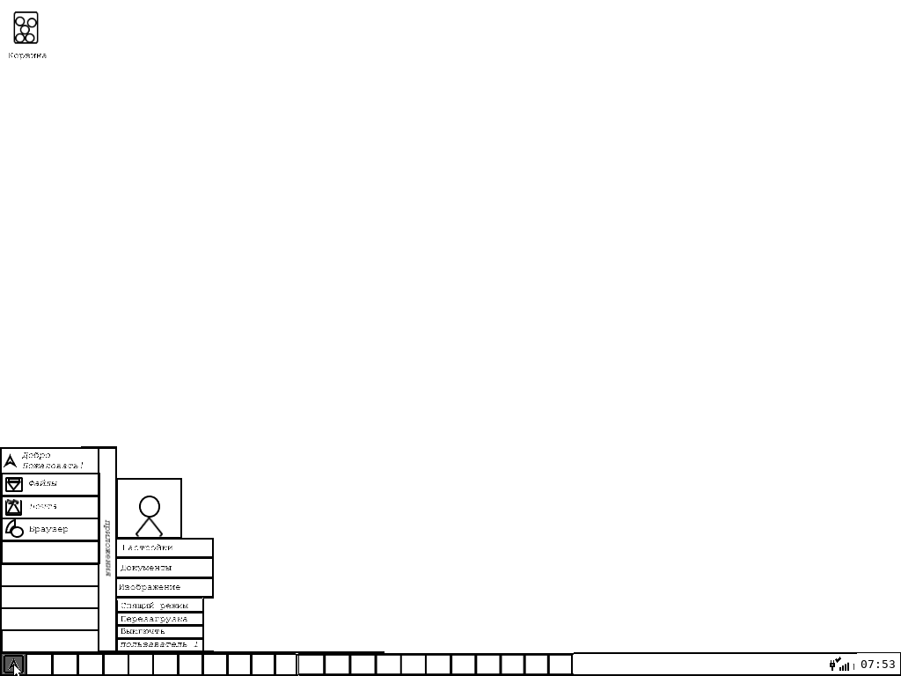
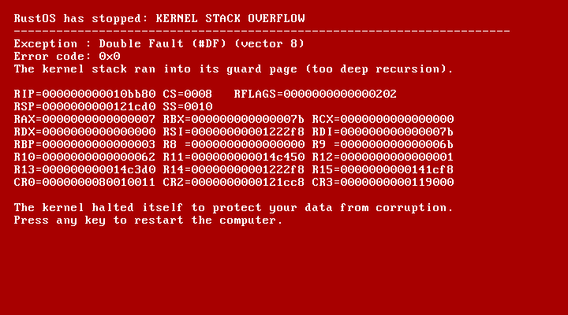

# RustOS

**RustOS** — настоящая 64-битная операционная система (ядро) для x86_64, написанная на Rust.
Она запускается прямо на «железе» или в QEMU, без Linux и без Windows под ней.

- никаких внешних библиотек (crates): только стабильный Rust и встроенный ассемблер;
- nightly-версия Rust **не нужна**, `bootimage` и прочие утилиты тоже;
- запуск одной командой: `cargo run`.



## Рабочий стол

После загрузки открывается графический рабочий стол. Его внешний вид — рисунок
[`theme/desktop.png`](theme/desktop.png): панель задач, меню, значок «Корзина»
берутся из него пиксель в пиксель. Ядро отвечает только за то, что где нажимается:

| Что | Действие |
|---|---|
| кнопка **A** на панели | открыть/закрыть меню |
| пункты меню (Файлы, Почта, Браузер, Настройки, Документы, Изображение, Приложения, пользователь) | открывают окно с таким названием |
| двойной щелчок по «Корзине» | открывает окно «Корзина» |
| **Спящий режим** | гасит экран до нажатия клавиши или кнопки мыши |
| **Перезагрузка**, **Выключить** | перезагрузка и выключение |
| квадраты на панели задач | открытые окна; щелчок сворачивает и разворачивает окно |
| заголовок окна / × | перетащить окно / закрыть |

Окна пока пустые: их содержимое ещё не нарисовано. В QEMU, чтобы отпустить
«захваченную» мышь, нажмите **Ctrl+Alt+G**.

**Как изменить внешний вид.** Перерисуйте `theme/desktop.png` (элементы должны
остаться на тех же местах) и выполните:

```bash
python3 tools/gen_theme.py    # нужен Python с Pillow: pip install pillow
cargo run --release
```

Если элементы сдвинулись, координаты областей указаны в начале `tools/gen_theme.py`
и в таблице `MENU_ITEMS` в `src/desktop/mod.rs`.

Текстовый режим с командной оболочкой: пункт **text mode** в меню загрузки ISO
(в QEMU без ISO: `cargo run --release -- -append text`).

## Готовый ISO-образ (самый простой способ)

Файл **[`dist/RustOS.iso`](dist/RustOS.iso)** уже собран, ничего компилировать не нужно.

* **QEMU (Windows):** двойной щелчок по `dist/run.bat`, или в терминале:
  `qemu-system-x86_64 -m 128M -cdrom RustOS.iso`
* **QEMU (Linux/macOS):** `./dist/run.sh`
* **VirtualBox:** «Создать» → тип *Other*, версия *Other/Unknown (64-bit)*, память 128 МБ,
  без жёсткого диска → в настройках «Носители» подключить `RustOS.iso` как оптический диск → «Запустить».
* **Реальный компьютер:** записать ISO на флешку программой Rufus (режим **DD**) или `dd`,
  в BIOS включить загрузку Legacy/CSM и загрузиться с флешки.

В меню загрузчика GRUB три пункта: рабочий стол, текстовый режим и самотесты.
Свежий ISO также публикуется на GitHub в разделе **Releases** после каждого изменения.

## Сборка из исходников

Нужны: Rust (через [rustup](https://rustup.rs)) и QEMU (`qemu-system-x86_64` должен быть в `PATH`).

```bash
cd rustos
cargo run --release
```

Первый запуск сам докачает компонент Rust для цели `x86_64-unknown-none` (это указано в
`rust-toolchain.toml`). Откроется окно QEMU с системой; всё, что она печатает,
дублируется в терминал (последовательный порт COM1), и команды можно набирать и там.

> **Windows:** если QEMU установлен, но команда не находится, добавьте папку QEMU
> (обычно `C:\Program Files\qemu`) в переменную `PATH` и откройте терминал заново.

### Команды оболочки

| Команда | Что делает |
|---|---|
| `help` | список команд |
| `about` | сведения о системе, адреса ядра, стека, защиты |
| `mem`, `memmap` | использование кучи ядра и карта физической памяти |
| `cpu` | модель процессора, возможности, частота |
| `uptime` | время работы, счётчики прерываний |
| `ls`, `cat`, `write`, `append`, `rm` | файлы на RAM-диске |
| `calc (2+3)*4` | целочисленный калькулятор |
| `color yellow` | цвет текста |
| `sleep 5` | пауза (Ctrl+C прерывает) |
| `history` | история команд |
| `selftest` | встроенные самотесты ядра |
| `int3` | вызвать исключение и продолжить работу |
| `crash panic\|null\|stack\|div0` | нарочно уронить ядро, чтобы увидеть аварийный экран |
| `reboot`, `shutdown` | перезагрузка и выключение |

Клавиши: ←/→/Home/End/Delete — редактирование строки, ↑/↓ — история, Tab — дополнение
команды, Ctrl+L — очистить экран, Ctrl+C — отменить строку, Ctrl+Alt+Del — перезагрузка.

Экран VGA в текстовом режиме умеет показывать только латиницу (кодовая страница CP437),
поэтому текстовая оболочка на английском. На рабочем столе (графика) русский текст есть.

## Что сделано для стабильности

| Защита | Что даёт |
|---|---|
| Обработчики для всех 256 векторов прерываний | неожиданное прерывание не перезагружает машину (нет тройной ошибки) |
| Отдельные стеки (IST) для Double Fault, NMI и Machine Check | обработчик работает, даже если основной стек сломан |
| Защитная страница под стеком ядра | переполнение стека ловится сразу (экран *KERNEL STACK OVERFLOW*), а не портит память |
| Нулевая страница не отображена | обращение по NULL-указателю — понятная ошибка Page Fault |
| Блокировки с выключением прерываний и обнаружением повторного входа | взаимоблокировка превращается в диагностику вместо зависания |
| Куча проверяет каждый `free` | двойное освобождение и порча памяти останавливают систему с сообщением |
| Проверки переполнения целых чисел в release-сборке | ошибки в арифметике не проходят молча |
| Ограниченные ожидания устройств | неисправный COM-порт или клавиатура не вешают ядро |
| Ложные IRQ 7/15 распознаются | контроллер прерываний не сбивается |
| Лимиты RAM-диска, калькулятора, строки ввода | ни одна команда не может съесть всю память или стек |
| Аварийный экран | при фатальной ошибке — полный отчёт (регистры, адрес, причина) и перезагрузка по клавише |



## Самотесты

```bash
./scripts/selftest.sh                                        # Linux / macOS
powershell -ExecutionPolicy Bypass -File scripts\selftest.ps1   # Windows
```

Ядро загружается с параметром `selftest`, проверяет кучу (2000 случайных выделений,
выравнивание, утечки, целостность списка), таймер, обработку исключений, RAM-диск
и калькулятор, после чего QEMU завершается с кодом результата. Эти же тесты
автоматически запускаются на GitHub при каждом изменении папки `rustos/`.

## Запуск на реальном компьютере или в VirtualBox

```bash
sudo apt install grub-pc-bin grub-common xorriso mtools   # один раз
./scripts/make-iso.sh                                     # получится dist/RustOS.iso
```

`RustOS.iso` можно подключить в VirtualBox/VMware как CD или записать на флешку
(например, `dd` или Rufus в режиме DD). Компьютер должен загружаться в режиме
**BIOS / Legacy (CSM)**: в чистом UEFI нет текстового режима VGA.

## Как устроено

```
src/
  boot.rs        Multiboot-заголовок, проверка CPU, таблицы страниц, вход в 64-битный режим
  main.rs        kernel_main: порядок инициализации, обработчик паники
  gdt.rs         GDT и TSS с отдельными стеками для аварийных исключений
  interrupts.rs  IDT, входы для 256 векторов (ассемблер), диспетчер
  fatal.rs       аварийный экран
  pic.rs time.rs контроллер прерываний 8259 и таймер PIT (100 Гц)
  keyboard.rs    клавиатура PS/2;  serial.rs — COM1;  input.rs — очередь клавиш
  vga.rs console.rs  экран 80x25 и вывод на экран + COM1
  heap.rs        распределитель памяти ядра (alloc: Vec, String, BTreeMap…)
  multiboot.rs   карта памяти и параметры от загрузчика
  fs.rs          RAM-диск;  calc.rs — калькулятор;  shell.rs — оболочка
  selftest.rs    самотесты;  power.rs — перезагрузка/выключение
  sync.rs cpu.rs блокировки и инструкции процессора
  desktop/       рабочий стол (механика; внешний вид — theme_data.rs из theme/desktop.png)
  gfx/           видеорежим (Bochs VBE или GRUB), холст, шрифт с кириллицей
  mouse.rs       мышь PS/2;  pci.rs — поиск видеокарты;  rtc.rs — часы
linker.ld        раскладка ядра в памяти (с адреса 1 МиБ)
```

Загрузка: QEMU (`-kernel`) или GRUB загружают ядро по протоколу Multiboot в 32-битном
режиме → `boot.rs` строит таблицы страниц (первые 4 ГиБ, тождественное отображение),
включает long mode → `kernel_main` настраивает GDT/TSS, IDT, PIC, таймер, клавиатуру,
COM1 и кучу → запускается оболочка.

Идеи для развития: многозадачность (переключение контекста по таймеру), режим
пользователя (ring 3) и системные вызовы, драйвер диска ATA/AHCI и файловая система
FAT, графический режим со шрифтом с кириллицей, сеть (virtio-net).
